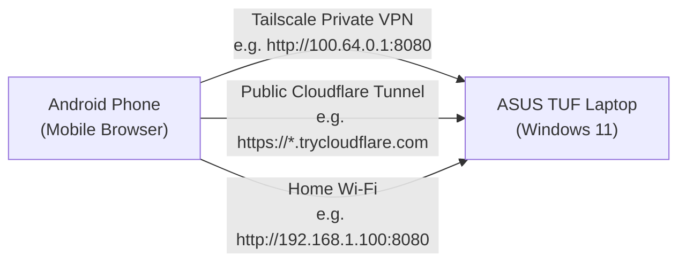

# ⚡ Remote Power Switch (Windows 11)

A fast, lightweight, and secure remote power management server built with native Windows PowerShell and HTML5/JavaScript. 

Remotely **Shutdown**, **Restart**, **Sleep**, or **Lock** your Windows PC (e.g., an **ASUS TUF Gaming Laptop**) directly from your **Android Phone** or any mobile web browser anywhere in the world.

---

## ✨ Features

- **Zero Heavy Runtimes**: 100% native PowerShell 5.1 HTTP server. No Node.js, Python, or IIS required.
- **Responsive Mobile Dashboard**: Modern dark-mode interface with live system telemetry (hostname, current user, battery %, uptime, and power status).
- **Two Connection Methods**:
  1. **Private Mesh Network (Tailscale)**: Fast, permanent direct link across cellular and Wi-Fi networks.
  2. **Zero-Setup Public Tunnel (Cloudflare)**: Instant temporary public URL with no port forwarding required.
- **PIN Protected**: Secure PIN authorization with instant lockout upon incorrect attempts.
- **Grace Period Timer**: Configurable countdown (default: 30s) allowing you to abort accidental shutdowns directly from your phone.
- **1-Click Windows Startup**: Optional background launcher that starts on Windows login.

---

## 📱 Architecture



---

## 🚀 Quick Start

### 1. Clone the Repository
```powershell
git clone <your-repo-url>
cd remote-shutdown
```

### 2. Configure Settings
Copy `config.example.json` to `config.json`:
```powershell
Copy-Item config.example.json config.json
```

Edit `config.json` with your desired PIN and port:
```json
{
  "port": 8080,
  "pin": "1234",
  "grace_period_seconds": 30,
  "allow_restart": true,
  "allow_sleep": true,
  "allow_lock": true
}
```

### 3. Launch
Double-click **`Start.bat`** (or run `.\Start-RemoteShutdown.ps1` in PowerShell).

The console will display:
```
  ================================================================
      POWER SWITCH · REMOTE SHUTDOWN IS ONLINE                    
  ================================================================

  PERMANENT TAILSCALE URL:
     http://100.64.0.1:8080

  PUBLIC INTERNET TUNNEL:
     https://random-word.trycloudflare.com

  LOCAL WI-FI URL:
     http://192.168.1.100:8080

  SECURITY PIN:
     1234
```

Open any of the URLs on your Android phone, enter your PIN, and manage your laptop's power state.

### 4. Stop
Double-click **`Stop.bat`** (or run `.\Stop-RemoteShutdown.ps1`).

---

## 🛡️ Optional: Run Automatically on Windows Startup

To have the server run silently in the background whenever you log into Windows:
- Run **`Install-Startup.bat`**
- To remove the startup entry later, run **`Uninstall-Startup.bat`**

---

## 📁 Repository Structure

```
remote-shutdown/
├── Start.bat                   # 1-click launcher
├── Stop.bat                    # 1-click terminator
├── Start-RemoteShutdown.ps1    # PowerShell orchestrator
├── Stop-RemoteShutdown.ps1     # Process terminator script
├── server.ps1                  # Native PowerShell HTTP server (Port 8080)
├── config.example.json         # Configuration template
├── Install-Startup.bat         # Installs shortcut in Windows Startup
├── Uninstall-Startup.bat       # Removes shortcut from Windows Startup
└── web/
    └── index.html              # Responsive mobile dashboard
```

---

## 🔒 Security & Privacy

- All actions require the security PIN configured in `config.json`.
- When using Tailscale, traffic is end-to-end encrypted across your private WireGuard mesh.
- No personal identifiers, IP addresses, or hardware MACs are committed to this repository.
